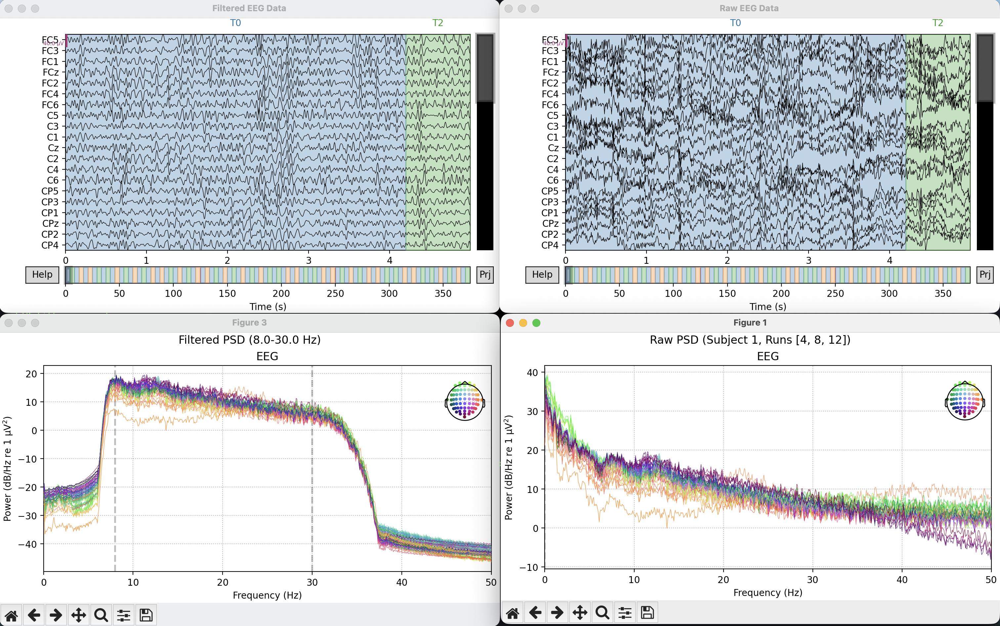
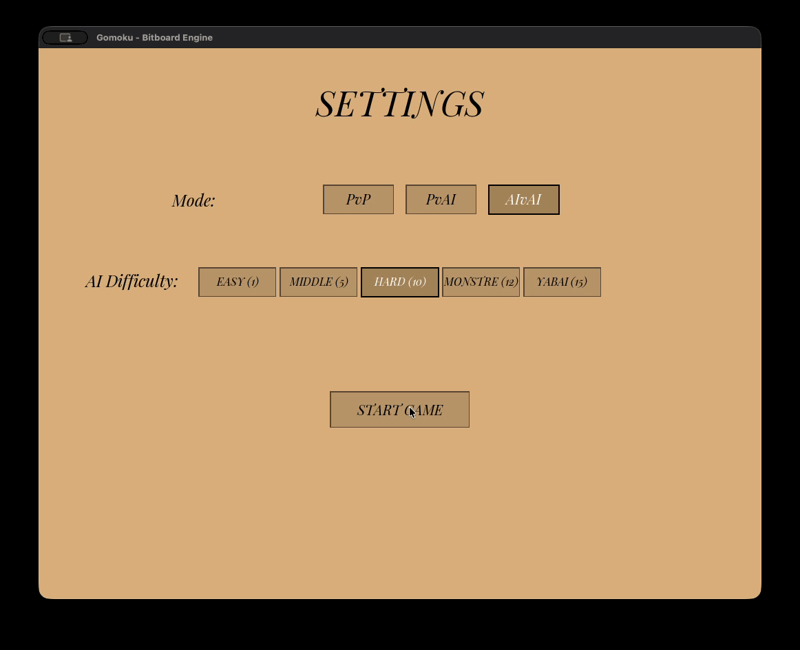

# Hello there, I'm Yuki Hosono! 👋

I’m currently a student at 42 Paris , seeking an internship starting in 2026 to complete my Master's level (RNCP 7) diploma

## 🚀 Skills

Here are the technologies I work with:

- **Languages:** C, C++, Python, Swift
- **Specialized:** Embedded AI Systems, Memory management, LLM Integration, Real-time P2P(BLE), Full-stack Development
- **Tools & DevOps:** Git, Docker, Linux, AWS(EC2), Redmine

## 🛠 Featured Projects

### 📂 [Total Perspective Vortex](https://github.com/hosonu/42_TotalPerspectiveVortex)

> A Brain-Computer Interface (BCI) project that classifies motor-imagery EEG signals, decoding imagined movements from brain activity using classical signal processing and machine learning.

- **Tech Stack:** Python, MNE, scikit-learn, NumPy/SciPy, PyWavelets
- **Key Features:**
  - 🧠 Built a custom **Common Spatial Patterns (CSP)** transformer from scratch for EEG spatial filtering.
  - 📊 Implemented an end-to-end ML pipeline with EEG preprocessing, feature extraction, LDA classification, and stratified cross-validation.
  - 🌊 Added optional Morlet wavelet-based spectral features for enhanced frequency-domain analysis.
  - ⚡ Simulated real-time EEG inference using a socket-based playback flow.

### 📂 [Gomoku](https://github.com/hosonu/42_Gomoku)

> Gomoku is a strategic board game where players alternate placing black and white stones on a 19x19 board. The objective is to be the first to form an unbroken line of five stones horizontally, vertically, or diagonally.

- **Tech Stack:** C++, Bitboards, Minimax Algorithm with Alpha-Beta Pruning
- **Key Features:**
  - ✨ Optimized move evaluation using **BitBoards** for near-instant decision-making.
  - 🚀 Sophisticated pruning techniques to explore deeper game trees within time constraints.

### 📂 [Echome](https://github.com/hosonu/Echome-iOS/tree/develop)
> A decentralized, real-time music sharing app using BLE to synchronize "Current Song" playback between nearby devices.

- **Tech Stack:** Swift, SwiftUI, MusicKit, CoreBluetooth
- **Key Features:**
  - 🎧 Seamless interaction with the user's music library and playback management using MusicKit
  - 🛜 Implementation of CoreBluetooth to establish and manage communication with external peripherals

## 📫 Connect with me

[LinkedIn](https://www.linkedin.com/in/yuki-hosono-264170390/)

---

### 📊 GitHub Stats

  
  

